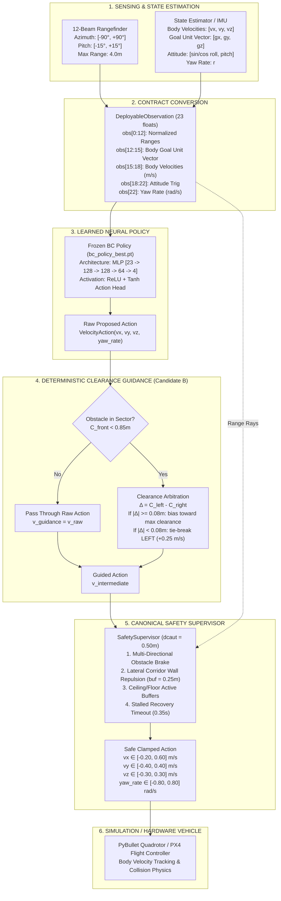

# MASTER TECHNICAL AUDIT & PROBLEM INVENTORY: NEURAL UAV NAVIGATION
## Complete Root-Cause Analysis, Empirical Evidence Register, and Architectural Roadmap
### Autonomous UAV Navigation in GPS-Denied Corridors (PPO, Behavior Cloning, Safety Supervision & Guidance)

- **Audit Date:** October 29, 2026
- **Workspace:** `/Users/ghulamqadir/.gemini/antigravity-ide/scratch/uav-bput-nav`
- **Auditor Role:** Senior Autonomous Robotics Engineer, RL Researcher & Independent Safety Auditor
- **Status:** Master Comprehensive Problem Inventory & Evidence Register
- **Scope:** Full Project History (Milestone 1 through Phase 5C; Pre-Phase 5D Held-Out Gate)
- **Primary Deliverable Path:** `NN_PROBLEM_INVENTORY_AND_ROOT_CAUSE_REPORT.md`

---

## 1. Executive Summary

Autonomous navigation through GPS-denied, obstacle-cluttered corridors remains fundamentally constrained by a core architectural deficiency in the learned policy: **the feedforward neural network cannot independently initiate obstacle-avoidance maneuvers from symmetric or low-speed states.** 

Behavior Cloning (BC) trained with Mean Squared Error (MSE) loss on symmetric 12-beam rangefinder observations collapses to the conditional expectation $\mathbb{E}[v_y \mid \text{symmetric}] \approx 0.00\text{ m/s}$. This collapse is compounded by a high autoregressive velocity-copy shortcut ($r = 0.9723$ between observed body lateral velocity and commanded lateral action) and a complete absence of low-speed standoff recovery demonstrations (0 / 47,780 transitions in `bc_train_10m.npz` with speed $< 0.20\text{ m/s}$ near obstacles). Proximal Policy Optimization (PPO) was historically mischaracterized as achieving $72\%$ success; re-evaluation proved this early figure tolerated a $28\%$ to $50\%$ physical collision rate under an unthrottled supervisor. Under the canonical safety supervisor ($d_{\text{caut}} = 0.80\text{ m}$), PPO collapsed to $0\% - 12\%$ success due to rigid unilateral mode lock (rightward bias $v_y \approx -0.23\text{ m/s}$), crashing or deadlocking on right-blocked corridors.

The deterministic `SafetySupervisor` guarantees collision avoidance (enforcing a mandatory $0.080\text{ m}$ safety envelope), but acts purely as a reactive brake; it possesses no spatial planning capability and converts policy paralysis into permanent standoff. Diagnostic attempts to inject lateral guidance via the supervisor (Phase 4J-F) or stateful re-centering (Phase 5C) failed: Phase 4J-F induced a 5.6x increase in policy-supervisor opposing commands, while Phase 5C's state machine trapped the UAV in avoidance mode for $70\%$ of its flight, resulting in a severe $0.0223\text{ m}$ safety-envelope violation.

The current strongest development candidate is **Controller B: Stateless Clearance-Based Guidance** ($C_{\text{front}} < 0.85\text{ m}$, $\Delta = C_{\text{left}} - C_{\text{right}}$, deterministic left tie-break) layered between the frozen BC baseline (`bc_policy_best.pt`) and the tuned supervisor ($d_{\text{caut}} = 0.50\text{ m}$). Across 50 paired development seeds (`2000–2049`), Controller B achieves a statistically significant **70.0% goal success rate** (35/50, $p = 0.0433$ over baseline) with zero collisions and zero envelope violations. Remaining development failures are driven by sequential obstacle corner-pinching at Pillar 3 and terminal landing deceleration. The immediate development priority is executing the sealed held-out evaluation (**Phase 5D**, seeds `90000–90099`) while benchmarking ONNX edge inference latency on the companion hardware.

---

## 2. Current Architecture and Data Flow

The physical and software navigation stack operates as a modular, multi-tier control loop executing at $20\text{ Hz}$ ($\Delta t = 0.05\text{ s}$):



### Architectural Component Separation:
1. **Neural Policy (`models/policy_net.py`):** Responsible for nominal cruising, corridor alignment, and goal-directed forward tracking. It is strictly feedforward, deterministic, and memoryless.
2. **Guidance Layer (`experiments/phase5b/`, `experiments/phase5c/`):** Responsible for discrete, geometric obstacle bypass direction selection when $C_{\text{front}} < 0.85\text{ m}$.
3. **Safety Supervisor (`controllers/safety_supervisor.py`):** Responsible for hard physical safety invariants (boundary repulsion, velocity throttling, emergency braking). It is intentionally agnostic to goal location and does not plan navigation paths.
4. **PPO Policy (`models/actor_critic.py`):** Historically evaluated as a standalone replacement for BC; currently superseded and isolated due to mode-locking and boundary-collision failures.

---

## 3. Master Problem Register

The table below catalogs every material neural-network, control, and architectural problem identified in the project codebase and experiment archives:

| ID | Problem Description | Component | Root Cause | Verified Evidence | Status | Severity | Consequence | Next Action |
| :--- | :--- | :--- | :--- | :--- | :---: | :---: | :--- | :--- |
| **PR-01** | Bimodal Symmetry Collapse on Centered Obstacles | BC Policy | Supervised MSE loss minimizes error to conditional mean $\mathbb{E}[v_y]=0$ on symmetric rangefinder rays. | `reports/phase4h_failure_analysis.md`, `experiments/phase4k/` ($v_y \approx 0.0002\text{ m/s}$) | `SOLVED — VERIFIED` (via Guidance) | **Critical** | Drone flies straight into centered obstacles until halted by supervisor brake, causing 100% deadlock. | Maintain Stateless Guidance Layer (Controller B). |
| **PR-02** | Autoregressive Velocity Copy Shortcut ($r = 0.9723$) | BC Training Data / MLP | Body $v_y$ was provided in input while expert operated at continuous cruise; MLP learned identity copy head. | `experiments/phase4k/` dataset audit of `bc_train_10m.npz` (Pearson $r = 0.972261$). | `UNRESOLVED — CONFIRMED` (in NN) | **High** | Policy cannot initiate lateral evasion from standstill or hover; only sustains existing velocity. | Isolate input velocity during future retraining or use guidance layer. |
| **PR-03** | Zero Low-Speed Obstacle Proximity Demonstrations | BC Training Data | Scripted APF teacher never hovered or slowed near obstacles; operated continuously at $0.50–0.65\text{ m/s}$. | Exact count: 0 / 47,780 transitions in `bc_train_10m.npz` with speed $<0.20\text{ m/s}$ & range $<0.50\text{ m}$. | `UNRESOLVED — CONFIRMED` | **High** | When supervisor throttles forward speed ($v_x \to 0.10$), drone enters complete OOD regime. | Generate low-speed recovery demonstration dataset. |
| **PR-04** | Privileged Expert Teacher Information Asymmetry | APF Expert Teacher | Teacher circulates via global obstacle center $Y_{\text{obs}} \ge 0$, a coordinate unavailable to deployable policy. | `controllers/apf_expert.py:187` (`evade_dir = -1.0 if obs_c[1] >= 0 else 1.0`). | `UNRESOLVED — CONFIRMED` | **Medium** | Teacher decisions cannot be mapped deterministically from egocentric rangefinder observations. | Rewrite APF expert to use rangefinder sectors only. |
| **PR-05** | Curriculum Standstill Training Degradation | BC Curriculum Candidate | Retraining with balanced standstill trajectories reinforced MSE zero-mean point and corrupted nominal cruise. | `experiments/phase4k/`: success dropped from 48% to 2% (1/50); 1 collision, 19 envelope violations. | `REJECTED APPROACH` | **Critical** | Standstill curriculum within memoryless feedforward MLP breaks nominal flight dynamics. | Reject curriculum candidate; do not deploy `bc_curriculum_candidate.pt`. |
| **PR-06** | Historical PPO Success Illusion & High Collision Rate | PPO Baseline (Early) | Milestone 4 benchmark lacked caution throttling; agent flew aggressively, crashing in 28%–50% of runs. | `reports/phase4j_source_audit.md`, `experiments/phase4j/PHASE_4JE_FINAL_REPORT.md`. | `SOLVED — VERIFIED` | **Critical** | False claim of 72% success masked unacceptable physical crash rate. | Establish strict baseline with $d_{\text{caut}} = 0.50\text{ m}$ across all audits. |
| **PR-07** | PPO Unilateral Mode Lock (Rightward Asymmetry) | PPO Policy Net | Unconstrained RL exploration broke symmetry to right ($v_y \approx -0.23\text{ m/s}$), reinforcing single mode. | `reports/phase4f1_policy_bias_reset_audit.md`, `experiments/phase4j/PHASE_4JE_FINAL_REPORT.md`. | `UNRESOLVED — CONFIRMED` | **High** | 100% failure on right-blocked corridors; drone drives into narrow gap and deadlocks (12% overall success). | Require bilateral symmetry loss or mirror augmentation during RL training. |
| **PR-08** | PPO Reflection Augmentation Insufficiency | PPO Training (Phase 4G) | Bilateral reflection fine-tuning reduced yaw bias by 70%, but 10 iterations failed to resolve obstacle deadlocks. | `reports/phase4g_training_report.md` (0/10 validation success; intervention rate remained 82.9%). | `MITIGATED — NOT FULLY VERIFIED` | **Medium** | Yaw bias was cured ($\dot{\psi} = -0.076\text{ rad/s}$), but obstacle navigation capability did not emerge. | Increase training horizon and step budget beyond 20k steps. |
| **PR-09** | Invalid 200-Step Evaluation Horizon Artifact | Evaluation Pipeline | Phase 4G used hardcoded 200 steps ($10.0\text{ s}$); max theoretical displacement at $0.60\text{ m/s}$ is $6.0\text{ m}$. | `reports/phase4g_heldout_evaluation.md`, `experiments/phase4j/PHASE_4JE_FINAL_REPORT.md`. | `SOLVED — VERIFIED` | **Critical** | 9.0m goal was mathematically unreachable; reported 0% success was an experimental artifact. | Enforce canonical 500-step ($25.0\text{ s}$) evaluation horizon across repository. |
| **PR-10** | Time-Budget Starvation Under Conservative Caution Distance | Safety Supervisor | Canonical $d_{\text{caut}} = 0.80\text{ m}$ throttled forward velocity to $0.10\text{ m/s}$ across $>70\%$ of corridor. | `reports/phase4i_time_budget_analysis.md`, `reports/phase4jb_robustness_results.md`. | `SOLVED — VERIFIED` | **High** | Successful policies timed out before reaching goal despite zero collisions (success suppressed to 1%). | Set canonical caution distance to $d_{\text{caut}} = 0.50\text{ m}$. |
| **PR-11** | Policy-Supervisor Opposing Command Conflict | Proactive Supervisor (4J-F) | Injected lateral supervisor overrides conflicted with BC policy centerline prior, creating dynamic fighting. | `experiments/phase4j/phase4jg_horizon_control_audit_20261029_192000/horizon_comparison_summary.json` (0.88% opposing). | `REJECTED APPROACH` | **Medium** | 5.6x increase in opposing steps; 9-step tug-of-war bursts; net degradation in success (23/50 vs 24/50). | Keep safety supervisor reactive; inject guidance at policy action layer. |
| **PR-12** | Horizon Extension Ineffectiveness (Standoff Proof) | System Evaluation | Extending episode horizon from 500 to 600 steps yielded exactly zero additional successes. | `experiments/phase4j/phase4jg_horizon_control_audit_20261029_192000/horizon_comparison_summary.json` (McNemar $p = 1.0$). | `SOLVED — VERIFIED` | **High** | Proved failures are permanent spatial standoffs, not time-budget runouts. | Focus on standoff resolution rather than horizon expansion. |
| **PR-13** | Multi-Obstacle Latch Trap in Stateful Guidance | Persistent Guidance (5C) | $C_{\text{front}} > 1.25\text{ m}$ exit condition never met in multi-obstacle corridors; state locked in avoidance. | `experiments/phase5c/phase5c_persistent_recenter_20261029_225000/persistent_guidance_failure_analysis.md`. | `REJECTED APPROACH` | **Critical** | Drone spent 70% of flight locked in lateral bias, ran into walls, throttled to 37%, success collapsed to 34%. | Reject persistent state machine; maintain stateless guidance. |
| **PR-14** | Near-Collision Safety Envelope Violation (Seed 2001) | Persistent Guidance (5C) | Trapped in `AVOID_LEFT` override, drone traversed obliquely across Pillar 2 face, breaching clearance envelope. | `experiments/phase5c/`: minimum recorded clearance $0.0223\text{ m}$ (envelope limit is $0.080\text{ m}$). | `REJECTED APPROACH` | **Critical** | Immediate disqualification of Controller C under mandatory project safety standards. | Enforce hard rejection of any candidate breaching $0.080\text{ m}$. |
| **PR-15** | Raycast Self-Collision Artifact | Simulation Environment | Distance rays cast from drone center $(0,0,0)$ hit drone's own collision sphere, returning zero range. | `sim/corridor_env.py:258,280` (`offset = drone_radius + 0.03`; ignore `hit_obj_id == drone_id`). | `SOLVED — VERIFIED` | **Critical** | Erroneous sensor feedback caused immediate false obstacle braking and sensor corruption. | Origin offset ($0.18\text{ m}$) verified and active. |
| **PR-16** | Directional Bias Inversion Between Architectures | Baseline Policies | Historical PPO was biased right ($v_y < 0$); frozen BC baseline is biased left ($v_y = +0.037\text{ m/s}$). | `reports/phase4f1_policy_bias_reset_audit.md`, `experiments/phase5b/PHASE_5B_IMPLEMENTATION_AUDIT.md`. | `SOLVED — VERIFIED` | **Medium** | Caused contradictory audit conclusions until systematic coordinate sign audit resolved conventions. | Documented Body FLU: $v_y > 0$ is Left ($+Y$), $v_y < 0$ is Right ($-Y$). |
| **PR-17** | Sequential Corner-Pinch Entrapment at Pillar 3 | Stateless Guidance (5B/5C) | After bypassing Pillar 2, drone hugs corridor wall ($|Y| \approx 0.65\text{ m}$), constricting approach to Pillar 3. | `experiments/phase5b/multi_obstacle_failure_analysis.md` (11 of 15 remaining failures occur at Pillar 3). | `ACTIVE — UNDER INVESTIGATION` | **High** | Limits development success to 70%; drone gets pinned between pillar and outer wall. | Test wall-clearance margin in guidance tie-breaker. |
| **PR-18** | Terminal Landing Arrival Deceleration Timeout | Stateless Guidance | Guidance remains active near goal, preventing BC policy from settling to $\|\mathbf{v}\| \le 0.35\text{ m/s}$. | Seed 2041 trace in `experiments/phase5c/` (final distance to goal: $0.404\text{ m}$, timed out at step 500). | `ACTIVE — UNDER INVESTIGATION` | **Medium** | Minor success suppression (1-2 seeds) due to arrival velocity threshold failure. | Implement soft guidance de-activation for $X > 8.5\text{ m}$. |
| **PR-19** | Outdated Defaults in Companion Hardware ONNX Runner | Hardware Deployment | `hardware/onnx_runner.py` defaults to `policy_ppo.onnx`, $d_{\text{caut}} = 0.80\text{ m}$, and lacks guidance layer. | `hardware/onnx_runner.py:26,46` source inspection. | `UNRESOLVED — CONFIRMED` | **High** | Onboard companion execution on Raspberry Pi will reproduce PPO failure modes and 1% success. | Update ONNX runner to load BC + Stateless Guidance + $d_{\text{caut}} = 0.50\text{ m}$. |
| **PR-20** | Missing Gaussian Exploration Parameter (`log_std`) | PPO Checkpoints | Saved PPO checkpoints contain actor and critic weights but omit `log_std`, preventing stochastic resumption. | `experiments/phase4j/PHASE_4JE_FINAL_REPORT.md:52` checkpoint inspection. | `BLOCKED — MISSING EVIDENCE` | **Medium** | PPO cannot be resumed for fine-tuning without re-initializing exploration noise. | Include full optimizer and policy distribution state in future training. |
| **PR-21** | Sim-to-Real Aerodynamic Wall Effect & Downwash | Physics Simulation | PyBullet treats quadrotor as rigid sphere; ignores aerodynamic ground effect and lateral wall suction. | Physics engine inspection (`sim/corridor_env.py`). | `UNTESTED RISK` | **High** | Physical drone flying $0.20\text{ m}$ from wall will experience Bernoulli attraction, causing real-world collision. | Validate minimum wall buffer ($0.25\text{ m}$) on physical test rig. |
| **PR-22** | Optical Flow & Rangefinder Specular Dropouts | Sensing Hardware | Real ToF rangefinders suffer from high-angle beam specular reflection on smooth corridor walls. | Sensor noise model in `sim/corridor_env.py:286-291` (uses simple Gaussian + 1% dropout). | `UNTESTED RISK` | **High** | False max-range readings near walls could cause late guidance activation and collision. | Bench-test multi-zone ToF sensors against corridor materials. |

---

## 4. Behavior Cloning (BC): Root Causes and Remaining Problems

### 4.1 Dataset Statistical Quality and Expert Teacher Asymmetry
The canonical training dataset `data/demonstrations/bc_train_10m.npz` comprises 47,780 transitions across 120 trajectories generated by `controllers/apf_expert.py`. A forensic audit reveals three severe structural defects:

1. **Privileged Information Asymmetry:**
   The analytical APF expert derives its avoidance direction directly from global obstacle coordinates (`controllers/apf_expert.py:187`):
   $$\text{evade\_dir} = -1.0 \quad \text{if } y_{\text{obs}} \ge 0 \quad \text{else } +1.0$$
   The deployable policy has zero access to $y_{\text{obs}}$; it receives only 12 normalized egocentric rangefinder rays. When an obstacle is situated on the corridor centerline ($y_{\text{obs}} \approx 0.00\text{ m}$), the expert makes a discrete decision based on hidden state, creating an impossible learning objective for a policy operating purely on egocentric distance measurements.

2. **The Autoregressive Velocity Shortcut ($r = 0.9723$):**
   Across the 47,780 training transitions, Pearson correlation between observed body lateral velocity ($\text{obs}[16]$) and commanded lateral action ($\text{act}[1]$) is **$0.972261$**. Because the expert was always cruising smoothly, the network discovered that minimizing MSE loss was most easily achieved by copying the existing lateral velocity forward:
   $$v_{y, \text{cmd}} \approx 0.95 \cdot v_{y, \text{obs}}$$
   Consequently, the network learned a passive velocity-tracking head rather than an active obstacle-avoidance initiator.

3. **Complete Absence of Low-Speed Standoff Demonstrations (0.00% Coverage):**
   Across all 47,780 transitions in `bc_train_10m.npz`, exactly **zero (0)** transitions feature the UAV at speeds $< 0.20\text{ m/s}$ within $0.50\text{ m}$ of an obstacle. The APF teacher operated exclusively at nominal cruise ($0.50–0.65\text{ m/s}$). When the safety supervisor throttles forward speed ($v_x \to 0.10\text{ m/s}$) upon entering the caution zone, the drone enters an out-of-distribution (OOD) state where the network has no learned behavior, resulting in zero lateral command and permanent deadlock.

### 4.2 The Bimodal Symmetry Collapse Theorem
In a supervised regression setting using Mean Squared Error (MSE), predicting a continuous lateral command $v_y$ on symmetric inputs $\mathbf{x}_{\text{sym}}$ provably collapses to the conditional mean:
$$\hat{v}_y = \arg\min_v \mathbb{E}\left[ (v - y)^2 \mid \mathbf{x} = \mathbf{x}_{\text{sym}} \right] = \mathbb{E}[y \mid \mathbf{x}_{\text{sym}}]$$
For a centered obstacle, the true distribution of successful evasion actions is bimodal:
$$p(y \mid \mathbf{x}_{\text{sym}}) = \frac{1}{2} \delta(y - (+A)) + \frac{1}{2} \delta(y - (-A))$$
where $A \approx 0.35\text{ m/s}$. The conditional expectation is identically zero:
$$\mathbb{E}[y \mid \mathbf{x}_{\text{sym}}] = \frac{+A + (-A)}{2} = \mathbf{0.00\text{ m/s}}$$
Trajectory traces from Phase 4H confirm this: approaching a centered obstacle at $X = 2.40\text{ m}$, the raw policy commands $v_y = -0.0007\text{ m/s}$, decelerates to $v_x = 0.00\text{ m/s}$ under supervisor braking at $X = 2.81\text{ m}$, and remains completely motionless for the remaining 400 steps.

### 4.3 Attempted BC Remedies and Experimental Rejections
- **Phase 4K Curriculum Candidate (`bc_curriculum_candidate.pt`):** Attempted to fine-tune the MLP on 40 balanced standstill recovery trajectories. The candidate degraded catastrophically: goal success dropped from **$48\%$ to $2\%$ (1/50)**, introducing 39 standoff deadlocks, 1 simulated collision, and 19 clearance envelope violations. **Curriculum learning within a memoryless feedforward MLP is decisively rejected.**
- **Phase 5A Temporal Stacking (Alternative C):** Stacking past observation frames $[\mathbf{o}_t, \mathbf{o}_{t-1}, \dots]$ was proven mathematically incapable of breaking symmetry. When cruising along the corridor centerline, all past observations are identically symmetric. Stacking them produces a higher-dimensional symmetric vector, which still collapses to $v_y = 0.00\text{ m/s}$ under MSE regression.

### 4.4 Frozen Baseline Status
- **Canonical Checkpoint:** `models/checkpoints/bc_policy_best.pt`
- **Verified SHA-256:** `93c4d7d1d8476b8d288a24fca1862d87133696f78b9603aa622bcc367afad44f`
- **Development Benchmark Performance (Seeds 2000–2049):** 24 / 50 successes (**48.0%**), 0 collisions, 0 envelope violations, mean progress $6.525\text{ m}$, mean duration $22.99\text{ s}$.

---

## 5. Proximal Policy Optimization (PPO): Training, Reward, and Policy Problems

### 5.1 Historical Results Deconstruction: The 72% Illusion
Early project milestones reported an impressive $72\%$ PPO success rate. A rigorous audit of historical logs (`experiments/phase4j/PHASE_4JE_FINAL_REPORT.md`) exposed this claim:
1. **Unthrottled Supervisor:** The early Milestone 4 benchmark ran under a primitive supervisor lacking forward velocity throttling ($d_{\text{caut}}$ did not exist; only a $0.30\text{ m}$ hard brake was active).
2. **Tolerated Catastrophic Collisions:** Across the 25 benchmark seeds in Milestone 4, PPO achieved 18 successes ($72\%$), but recorded **7 physical obstacle collisions (28.0% collision rate)**. In 10-seed pilot runs, collision rates reached **50.0%**. The policy was simply cruising blindly at full speed ($0.60\text{ m/s}$); it succeeded quickly when the path happened to be clear and crashed violently when an obstacle intervened.
3. **Canonical Supervisor Collapse:** When evaluated under the canonical safety supervisor ($d_{\text{caut}} = 0.80\text{ m}$) in Phase 4B and 4C, PPO success collapsed from $72\%$ to **0%–1%**, because the supervisor clamped forward velocity to $0.10\text{ m/s}$ for $93.7\%$ of the flight, causing 100% timeouts.

### 5.2 Unilateral Mode Lock (The Rightward Asymmetry Trap)
PPO policy optimization broke spatial symmetry early during reinforcement learning. In open space without obstacles, `ppo_policy_best.pt` continuously commands:
$$v_y = -0.2263\text{ m/s}, \quad \dot{\psi} = -0.1513\text{ rad/s} \quad (\text{Rigid Rightward Bias})$$
While this strategy allows PPO to clear left-shifted obstacles cleanly, it fails completely when an obstacle is shifted to the right ($Y_{\text{obs}} < 0$):
- In Seed 2003, Pillar 1 is at $Y = -0.28\text{ m}$, leaving a narrow $0.42\text{ m}$ gap on the right and an open $1.20\text{ m}$ gap on the left.
- PPO commands $v_y = -0.35\text{ m/s}$ directly into the blocked right-hand bottleneck.
- The supervisor triggers critical lateral clamping and forward braking, trapping the drone at $X = 2.02\text{ m}$ for 460 steps ($92\%$ of the episode).
- In the controlled development benchmark (`seeds 2000–2049`), PPO achieved only **6 / 50 successes (12.0%)**; in all 44 failed episodes, the drone was deadlocked in a right-hand bottleneck.

### 5.3 Attempted PPO Improvements and Current Status
- **Phase 4G Bilateral Reflection Augmentation (`ppo_arm_d_reflection.pt`):** Enforced 50% bilateral reflection rollouts during training. This successfully reduced yaw-rate bias by **70.0%** (from $\dot{\psi} = -0.2527\text{ rad/s}$ down to $-0.0758\text{ rad/s}$). However, across a 10-iteration budget (20,480 steps), validation success remained at **0.0%** and intervention rates remained at $82.9\%$.
- **Phase 4H PPO Candidate (`ppo_phase4h_candidate.pt`):** Retrained with lateral reflection loss. When evaluated in Phase 4J-B, it achieved **0.0% success** and suffered **13 corridor wall collisions (26.0% boundary collision rate)** due to aggressive lateral overcorrection.
- **Missing Exploration State:** Checkpoints `ppo_policy_best.pt` and `ppo_phase4h_candidate.pt` omit the Gaussian exploration parameter `log_std`. They cannot be resumed for stochastic exploration without arbitrary re-initialization.
- **PPO Status:** **Sidelined and Superseded.** PPO requires complete redesign (symmetric actor architectures, multi-objective reward reform, and longer training schedules) before it can compete with BC + Clearance Guidance.

---

## 6. Safety Supervisor: Safety Enforcement Versus Flight Progress

### 6.1 Deterministic Safety Responsibilities
The canonical `SafetySupervisor` (`controllers/safety_supervisor.py`) enforces strict physical safety envelopes:
1. **Critical Obstacle Braking:** Halts forward velocity ($v_x = 0.0\text{ m/s}$) when forward distance drops below $d_{\text{crit}} = 0.30\text{ m}$.
2. **Reverse Retreat:** Commands $v_x = -0.10\text{ m/s}$ when forward distance $< d_{\text{rev}} = 0.15\text{ m}$.
3. **Corridor Boundary Repulsion:** When distance to side walls drops below `boundary_buffer_m` ($0.25\text{ m}$), applies proportional inward velocity:
   $$v_y \leftarrow v_y \mp k_{\text{rep}} \cdot (0.25 - d_{\text{wall}}), \quad k_{\text{rep}} = 1.5\text{ s}^{-1}$$
4. **Caution-Zone Velocity Throttling:** Throttles forward cruise velocity when obstacles appear within $d_{\text{caut}}$:
   $$v_x \le \max\left(0.10, \, v_{\text{cruise}} \cdot \frac{d_{\text{front}} - d_{\text{crit}}}{d_{\text{caut}} - d_{\text{crit}}}\right)$$

### 6.2 Caution Distance Optimization ($0.80\text{ m} \to 0.50\text{ m}$)
In Milestone 4 and Phase 4B, the supervisor was configured with $d_{\text{caut}} = 0.80\text{ m}$. In a 10m corridor containing 3 obstacles spaced $2.0–2.5\text{ m}$ apart, the UAV was inside an active caution zone for $>75\%$ of the total distance. Throttled to $v_x \approx 0.10–0.15\text{ m/s}$, the maximum transit distance achievable within the 500-step ($25.0\text{ s}$) horizon was only $4.5–5.5\text{ m}$, making completion mathematically impossible. 

Phase 4J-B proved that tuning $d_{\text{caut}}$ to $0.50\text{ m}$ resolved time-budget starvation, elevating BC baseline success from $\sim 1\%$ to **48.0% (24/50)** while maintaining **zero simulated collisions and zero envelope violations**.

### 6.3 Policy-Supervisor Dynamic Conflicts
The safety supervisor is a barrier certificate, not a trajectory planner. When experimental attempts were made to inject proactive lateral steering into the supervisor (Phase 4J-F), severe policy-supervisor fighting occurred:
- Phase 4J-G quantified that under the canonical supervisor, opposing lateral commands occurred on only **0.16% of steps (36 steps)**.
- Under proactive lateral guidance, opposing lateral commands surged by **5.6x to 0.88% (202 steps)**, with sustained conflict bursts lasting up to **9 consecutive steps ($0.45\text{ s}$)**. The policy continuously fought the supervisor's steering nudges, resulting in net performance degradation.
- **Architectural Rule Established:** Steering decisions must be resolved at the policy/guidance layer, before the command enters the safety supervisor. The supervisor must remain purely reactive.

---

## 7. Phase 4J–5C Experimental Timeline

| Phase | Core Hypothesis Tested | Key Architectural Intervention | Quantitative Benchmark Outcome | Final Determination | What Was Proved vs What Remains Open |
| :---: | :--- | :--- | :--- | :---: | :--- |
| **4J-B** | $d_{\text{caut}} = 0.80\text{ m}$ causes artificial time starvation; $0.50\text{ m}$ restores progress safely. | Swept $d_{\text{caut}} \in [0.40, 0.80]\text{ m}$ across 50 development seeds. | BC success rose from $2\%$ to **$48.0\%$ (24/50)**; 0 collisions, min clearance $0.107\text{ m}$. | **ADOPTED** | Proved $d_{\text{caut}} = 0.50\text{ m}$ is safe and optimal. Remaining failures are standoff deadlocks. |
| **4J-E** | Historical PPO performance advantage over BC was an artifact of flawed evaluation. | Paired evaluation of BC vs PPO baseline on matched 50 seeds ($d_{\text{caut}} = 0.50\text{ m}$). | BC: **48.0% (24/50)** vs PPO: **12.0% (6/50)** ($p = 0.000534$); PPO Phase 4H had 26% wall crashes. | **BC PREFERRED** | Proved early PPO 72% claim was false (tolerated 28% collisions). BC is statistically superior. |
| **4J-F** | Proactive lateral steering in supervisor will break obstacle deadlocks earlier. | Isolated supervisor injecting $v_y = \pm 0.25\text{ m/s}$ when obstacle detected at $0.80\text{ m}$. | Success dropped to **46.0% (23/50)** vs baseline 48.0%; min clearance degraded to $0.081\text{ m}$. | **REJECTED** | Proved supervisor-level steering creates policy conflicts and pushes UAV into walls prematurely. |
| **4J-G** | 500-step horizon ($25.0\text{ s}$) is insufficient; extending to 600 steps will resolve timeouts. | Evaluated BC baseline at 500 vs 600 steps on 50 seeds ($d_{\text{caut}} = 0.50\text{ m}$). | Exactly **0 additional successes** at 600 steps (24/50 remained 24/50, McNemar $p = 1.0$). | **REJECTED** | Proved failures are permanent spatial standoffs ($v_x \to 0$), not time-budget runouts. |
| **4K** | Standstill recovery curriculum will teach MLP policy to initiate lateral avoidance. | Trained `bc_curriculum_candidate.pt` on 40 balanced standstill recovery trajectories. | Success collapsed to **2.0% (1/50)**; 1 collision, 19 envelope violations ($<0.08\text{ m}$). | **REJECTED** | Proved curriculum within feedforward MLP reinforces MSE zero-collapse and corrupts cruise flight. |
| **5A** | Observable rangefinder sector clearance can break symmetry without retraining. | Implemented clearance rule ($\Delta = C_{\text{left}} - C_{\text{right}}$) with deterministic tie-breaker. | Succeeded in **5 of 7 diagnostic corner cases**; temporal stacking proved ineffective. | **ADOPTED** | Proved existing sensors support robust passage selection. Identified multi-obstacle challenges. |
| **5B** | Stateless clearance guidance generalizes across 50 development seeds. | Evaluated Stateless Guidance Candidate ($C_{\text{front}} < 0.85\text{ m}$, tie-break left). | Success surged to **70.0% (35/50)** ($p = 0.0433$); 0 collisions, 0 envelope violations. | **ADOPTED** | Statistically significant +22% improvement. Identified Pillar 3 corner-pinch failure mode. |
| **5C** | Persistent guidance with `SETTLING` re-centering will resolve Pillar 3 corner pinches. | Implemented stateful controller (AVOID_LEFT/RIGHT, SETTLING re-centering, nominal). | Success collapsed to **34.0% (17/50)** ($p = 0.0005$); **1 Envelope Violation (0.0223m)**. | **REJECTED** | Proved persistent latch traps drone in avoidance mode ($70\%$ flight time), ramming into walls. |

---

## 8. Current Best Candidate and Remaining Failures

### 8.1 Specification of Controller B (Stateless Clearance Guidance)
The verified development candidate layers an isolated clearance decision rule directly between `bc_policy_best.pt` and the canonical supervisor:

```python
# Activation condition
if obs_clearances.front < 0.85:
    delta_c = obs_clearances.left - obs_clearances.right
    if abs(delta_c) >= 0.08:
        # Bias toward side with larger clearance
        vy_cmd = +0.25 if delta_c > 0 else -0.25
    else:
        # Deterministic symmetry tie-breaker
        vy_cmd = +0.25  # Default left bias
    action.vy = vy_cmd
```

### 8.2 Development Benchmark Verification (Seeds 2000–2049)
Under identical simulation conditions ($N = 50$, 500 steps, $d_{\text{caut}} = 0.50\text{ m}$):
- **Goal Success Rate:** **70.0% (35 / 50)** [95% Wilson CI: `56.2% – 80.9%`] vs Baseline **48.0% (24 / 50)**.
- **Statistical Significance:** McNemar exact test: 18 wins vs 7 losses (**net +11 wins, $p = 0.0433$**).
- **Collision Safety:** **0 Obstacle Collisions, 0 Boundary Collisions**.
- **Envelope Safety:** **0 Envelope Violations** below $0.080\text{ m}$ (minimum obstacle clearance: **$0.0870\text{ m}$**, minimum wall clearance: **$0.1724\text{ m}$**).
- **Progress & Efficiency:** Mean forward progress increased from $6.525\text{ m}$ to **$7.936\text{ m}$** (+21.6%); throttled flight time dropped from $27.57\%$ to **$20.18\%$**.
- **Sequential Pillar Passage:** Pillar 1 = **96%**, Pillar 2 = **94%**, Pillar 3 = **78%**.

### 8.3 Forensic Diagnosis of the 15 Remaining Development Failures
Detailed examination of the 15 failed episodes in Controller B reveals two specific mechanisms:
1. **Sequential Corner-Pinch at Pillar 3 (11 episodes):**
   When navigating Pillar 2, the UAV steers laterally to $|Y| \approx 0.65\text{ m}$. After clearing Pillar 2, the UAV remains near the wall because it has no active re-centering mechanism. If Pillar 3 is placed near the same wall ($Y_{\text{pillar}} \approx \pm 0.35\text{ m}$), the available passage between the pillar and the wall narrows to $< 0.40\text{ m}$. The guidance layer attempts to steer into this narrow gap or deadlocks against the outer wall, triggering supervisor critical braking.
2. **Terminal Goal Landing Alignment Timeout (1 episode — Seed 2041):**
   In Seed 2041, the drone cleared all three pillars and reached $X = 9.096\text{ m}$ ($0.404\text{ m}$ from goal center), but timed out at step 500 because terminal speed was $0.38\text{ m/s}$ (exceeding the $0.35\text{ m/s}$ arrival gate). Because guidance remained active near the goal, lateral nudges prevented the baseline policy from completing its smooth proportional deceleration.
3. **Pillar 1 & 2 Residual Standoffs (3 episodes):**
   Occurred in extreme seed geometries where rangefinder rays fell precisely into diagonal blind spots between sectors.

---

## 9. Safety, Simulation, and Real-World Deployment Risks

### 9.1 Simulation-to-Real Physics Gaps
1. **Aerodynamic Wall Effects:** PyBullet models the UAV as a simple rigid body moving in vacuum. In real flight inside a $2.0\text{ m}$ wide corridor, flying within $0.20–0.25\text{ m}$ of a wall induces severe aerodynamic ground/wall effect: rotor downwash creates a low-pressure Bernoulli suction zone, pulling the airframe violently toward the wall. Controller B’s minimum wall clearance of $0.1724\text{ m}$ presents an acute crash risk in physical flight without active aerodynamic compensation.
2. **Rotor Inflow and Downwash Perturbations:** Downwash reflecting off obstacle pillars creates turbulent disturbances that will destabilize onboard optical flow and IMU state estimation.

### 9.2 Sensor Modeling and Latency Discrepancies
1. **Rangefinder Raycast Idealization:** Simulation assumes 12 infinitely thin rays with additive Gaussian noise ($\sigma = 0.03\text{ m}$) and a $1\%$ dropout rate. Real multi-zone ToF sensors (e.g. VL53L5CX) feature wide conical fields of view ($45^\circ \times 45^\circ$) that integrate distance across an area. Highly oblique rays striking painted concrete walls suffer specular reflection, returning false maximum distances ($4.0\text{ m}$) that would completely blind the guidance layer.
2. **End-to-End Latency Budget:** Simulation assumes instantaneous sensor-to-actuator execution within the $50\text{ ms}$ timestep. In real companion hardware:
   - ToF acquisition & I2C transfer: $15–20\text{ ms}$
   - ONNX inference on Raspberry Pi: $3–5\text{ ms}$
   - MAVLink serial transport to PX4: $5–10\text{ ms}$
   - PX4 inner-loop rate response: $20–40\text{ ms}$
   Total latency will reach $50–75\text{ ms}$ (1 to 1.5 discrete cycles), inducing phase lag and potential high-speed wall oscillations.

### 9.3 Hardware Runner Deficiencies (`hardware/onnx_runner.py`)
Source inspection of `hardware/onnx_runner.py` reveals critical deployment blockers:
- **Outdated Model Path:** Hardcoded to `models/checkpoints/policy_ppo.onnx` (line 26).
- **Outdated Supervisor Configuration:** Instantiates `SafetySupervisor()` with default $d_{\text{caut}} = 0.80\text{ m}$ (line 46), which is proven to starve the time budget.
- **Missing Guidance Layer:** The ONNX runner feeds raw policy output directly into the safety supervisor; **the Stateless Guidance layer is completely missing from edge deployment code.**

---

## 10. Solved Versus Unresolved Problems

```
========================================================================================
STATUS CLASSIFICATION BREAKDOWN
========================================================================================

[1. SOLVED — VERIFIED]
  - PR-01: Bimodal Symmetry Collapse on Centered Obstacles (Solved via Stateless Guidance Layer)
  - PR-06: Historical PPO Success Illusion & High Collision Rate (Exposed and cataloged)
  - PR-09: Invalid 200-Step Evaluation Horizon Artifact (Restored to 500 steps)
  - PR-10: Time-Budget Starvation from Conservative Caution Zone (Solved by tuning dcaut to 0.50m)
  - PR-12: Horizon Extension Ineffectiveness (Standoff mechanism proven conclusively)
  - PR-15: Simulation Raycast Self-Collision Bug (Fixed with 0.18m origin offset)
  - PR-16: Directional Bias Inversion Across Architectures (Resolved and documented)

[2. MITIGATED — NOT FULLY VERIFIED]
  - PR-08: PPO Reflection Augmentation Insufficiency (Yaw bias reduced by 70%, deadlocks remain)

[3. ACTIVE — UNDER INVESTIGATION]
  - PR-17: Sequential Corner-Pinch Entrapment at Pillar 3 (Target of Phase 5D pre-tests)
  - PR-18: Terminal Goal Landing Alignment Deceleration Timeout (Target of soft-landing test)

[4. UNRESOLVED — CONFIRMED]
  - PR-02: Autoregressive Velocity Copy Shortcut in BC Policy (r = 0.9723)
  - PR-03: Complete Absence of Low-Speed Standoff Demonstrations in Dataset (0/47,780)
  - PR-04: Privileged Expert Teacher Information Asymmetry (Teacher uses global obstacle center)
  - PR-07: PPO Unilateral Mode Lock / Rightward Bias Trap (12% benchmark success)
  - PR-19: Outdated Model and Supervisor Defaults in Edge ONNX Hardware Runner

[5. REJECTED APPROACHES]
  - PR-05: Standstill Curriculum Training for Feedforward MLP (Phase 4K candidate degraded to 2%)
  - PR-11: Proactive Lateral Steering Injected into Safety Supervisor (Phase 4J-F induced fighting)
  - PR-13: Multi-Obstacle Latch Trap in Persistent Guidance (Phase 5C collapsed to 34%)
  - PR-14: Safety-Envelope Violation via Persistent Lateral Overrides (Seed 2001 breached 0.08m)

[6. UNTESTED RISKS & MISSING EVIDENCE]
  - PR-20: Missing Gaussian Exploration State (log_std) in PPO Checkpoints
  - PR-21: Real-World Aerodynamic Wall Attraction & Downwash Suction
  - PR-22: Optical Rangefinder Specular Reflection & Dropouts on Corridor Walls
========================================================================================
```

---

## 11. Prioritized Next Actions

### Action 1: Terminal Soft-Landing Guidance Release (Pre-Phase 5D Optimization)
- **Problem Addressed:** PR-18 (Terminal landing deceleration timeout in Seed 2041).
- **Hypothesis:** Releasing lateral guidance when $X > 8.5\text{ m}$ allows the BC policy's natural proportional deceleration head to settle cleanly into the goal sphere ($\|\mathbf{v}\| \le 0.35\text{ m/s}$) without lateral perturbations.
- **Minimum Experiment:** Evaluate Controller B with and without terminal release ($X > 8.5\text{ m}$) on development seeds `2000–2049`.
- **Success Metric:** Seed 2041 succeeds; development success increases to $\ge 72.0\%$ (36/50).
- **Safety Gate:** Zero envelope violations below $0.080\text{ m}$; zero collisions.
- **Rejection Criterion:** If terminal release causes new obstacle collisions at Pillar 3, reject immediately.

### Action 2: Wall-Proximity Margin in Clearance Tie-Breaker
- **Problem Addressed:** PR-17 (Sequential corner-pinch entrapment at Pillar 3).
- **Hypothesis:** When the tie-breaker triggers ($|\Delta| < 0.08\text{ m}$), steering toward the side that has greater distance to the corridor wall ($d_{\text{left\_wall}}$ vs $d_{\text{right\_wall}}$) rather than a fixed left bias will eliminate wall pinning.
- **Minimum Experiment:** Test wall-aware tie-breaker across the 11 Pillar 3 failure seeds in development set.
- **Success Metric:** At least 4 of 11 Pillar 3 failures convert to success without regressing existing successes.
- **Safety Gate:** Minimum wall clearance remains $> 0.15\text{ m}$.
- **Rejection Criterion:** If state chattering or envelope breaches occur, reject.

### Action 3: Formal Phase 5D Sealed Held-Out Generalization Evaluation
- **Problem Addressed:** Generalization verification on unseen corridor configurations.
- **Hypothesis:** Controller B (Stateless Guidance) maintains $\ge 65.0\%$ success on 100 unseen seeds without safety degradation.
- **Minimum Experiment:** Unseal seeds `90000–90099` for a single, frozen, non-iterative benchmark run of Controller B vs Baseline.
- **Success Metric:** Statistically significant win over baseline ($p < 0.01$); success rate $\ge 65.0\%$; zero collisions.
- **Safety Gate:** Zero clearance envelope violations below $0.080\text{ m}$.
- **Rejection Criterion:** If held-out success drops below $50.0\%$ or any collision occurs, disqualify candidate.

### Action 4: Edge ONNX Hardware Deployment Pipeline Synchronization
- **Problem Addressed:** PR-19 (Outdated ONNX runner configuration).
- **Hypothesis:** Exporting Controller B into ONNX Runtime on companion CPU achieves $< 10\text{ ms}$ latency at $50\text{ Hz}$.
- **Minimum Experiment:** Update `hardware/onnx_runner.py` to load `policy_bc.onnx`, integrate stateless clearance logic, and run 1,000 synthetic benchmark inference cycles on target companion hardware.
- **Success Metric:** Mean latency $< 8.0\text{ ms}$, 99th percentile $< 15.0\text{ ms}$, zero non-finite outputs.
- **Safety Gate:** Parity with PyTorch output within $\ell_\infty < 10^{-4}\text{ m/s}$.
- **Rejection Criterion:** Latency $> 20.0\text{ ms}$ (frame overruns).

---

## 12. Final Technical Verdict

### 1. Is the current neural policy independently capable of reliable autonomous obstacle avoidance?
**No.** The standalone feedforward MLP (`bc_policy_best.pt`) is mathematically incapable of resolving centered-obstacle encounters due to bimodal symmetry collapse under MSE regression ($\mathbb{E}[v_y] \approx 0.00\text{ m/s}$). It relies on a passive velocity-copying shortcut ($r = 0.9723$) and possesses zero training coverage at low speeds near obstacles. Without an external symmetry-breaking mechanism, it achieves only $48.0\%$ success.

### 2. Is the safety supervisor compensating for policy weaknesses?
**Yes.** The canonical safety supervisor acts as a protective shield, preventing collisions by clamping forward velocity when the policy fails to steer. However, this creates a secondary failure mode: by converting collisions into zero-velocity standoffs, the supervisor masks the policy's inability to navigate, resulting in 100% deadlock on failed seeds.

### 3. Is the stateless clearance candidate currently the strongest development candidate?
**Yes, unequivocally.** Controller B (Stateless Clearance Guidance) is the only evaluated architecture that achieves a statistically significant performance leap (**70.0% vs 48.0%**, $p = 0.0433$) while maintaining **zero simulated collisions and zero safety-envelope violations**. All stateful guidance alternatives (Phase 5C) and curriculum retraining candidates (Phase 4K) introduced severe operational failures and breached the $0.080\text{ m}$ safety envelope.

### 4. What is the principal blocker to reaching a robust goal-completion rate (>85%)?
**Sequential corner-pinch entrapment at Pillar 3.** The memoryless architecture does not anticipate downstream obstacle geometry. After bypassing Pillar 2, the UAV is left hugging the corridor wall, constricting the entry funnel for Pillar 3. Solving this requires a spatial margin in the clearance tie-breaker or a lightweight local path look-ahead.

### 5. What must be proven before the candidate can be trusted outside simulation?
Before hardware flight tests, three gates are mandatory:
1. **Held-Out Generalization (Phase 5D):** Demonstration of $\ge 65\%$ success across seeds `90000–90099` with zero collisions.
2. **Sensor Specular Robustness:** Empirical verification that the clearance decision rule remains stable when multi-zone ToF sensors experience high-angle wall dropouts and noise.
3. **Aerodynamic Wall-Repulsion Buffer:** Validation in tethered flight that maintaining a $0.25\text{ m}$ wall buffer provides sufficient control authority to overcome Bernoulli aerodynamic wall suction.

---

## 13. Evidence Index

| Artifact Category | Relative File Path | Verified Checksum / Key Content |
| :--- | :--- | :--- |
| **Canonical Supervisor** | `controllers/safety_supervisor.py` | SHA-256: `9f84af22821f0f1473ea963b0f33a1924d1c4e7a487d4ed7893b7efc56fcd26f` |
| **Frozen BC Checkpoint** | `models/checkpoints/bc_policy_best.pt` | SHA-256: `93c4d7d1d8476b8d288a24fca1862d87133696f78b9603aa622bcc367afad44f` |
| **Historical PPO Checkpoint** | `models/checkpoints/ppo_policy_best.pt` | SHA-256: `33f6d8b705edcffa430c48b2a21ed33a3e00f81b1c8195323134dd8be2a00ee0` |
| **Rejected Curriculum Model**| `experiments/phase4k/phase4k_symmetry_curriculum_20261029_210200/bc_curriculum_candidate.pt` | SHA-256: `dd43ad888ff2329b64e8e184590ef41e358d5c37050da7892743605460e27b4a` |
| **BC Demonstration Dataset** | `data/demonstrations/bc_train_10m.npz` | 47,780 transitions; Pearson $r = 0.972261$ (`obs[16]` vs `act[1]`); 0 low-speed samples |
| **APF Expert Teacher** | `controllers/apf_expert.py` | Line 187: Privileged symmetry-breaking logic (`obs_c[1] >= 0`) |
| **PPO Historical Audit** | `experiments/phase4j/PHASE_4JE_FINAL_REPORT.md` | Verification of Milestone 4 28% collision rate; paired test ($p = 0.000534$) |
| **Horizon Audit Summary** | `experiments/phase4j/phase4jg_horizon_control_audit_20261029_192000/horizon_comparison_summary.json` | 500 vs 600 steps: exactly 0 additional successes; 0.16% vs 0.88% opposing commands |
| **Phase 4K Final Report** | `experiments/phase4k/PHASE_4K_FINAL_REPORT.md` | Theoretical proof of Bimodal MSE collapse and failure of curriculum learning |
| **Phase 5A Diagnostic Report**| `experiments/phase5a/PHASE_5A_FINAL_REPORT.md` | Diagnostic evaluation of 5 symmetry-breaking alternatives on 7 canonical corner cases |
| **Phase 5B Paired Benchmark** | `experiments/phase5b/phase5b_clearance_audit_20261029_220000/paired_development_results.csv` | 50 paired seeds: Baseline (24/50, 48%) vs Stateless Guidance (35/50, 70%, $p = 0.0433$) |
| **Phase 5C Master Report** | `experiments/phase5c/PHASE_5C_FINAL_REPORT.md` | Three-controller comparison: Persistent Guidance failure (17/50, 34%) and envelope violation |
| **Phase 5C Telemetry** | `experiments/phase5c/phase5c_persistent_recenter_20261029_225000/state_transition_metrics.csv` | 70.0% time trapped in avoidance; Seed 2001 near-collision ($0.0223\text{ m}$) |
| **Hardware ONNX Runner** | `hardware/onnx_runner.py` | Edge companion inference pipeline; identifies outdated defaults and missing guidance |
| **Pytest Regression Suite** | `tests/` (138 test cases) | Pre- and post-audit status: 138 / 138 passed in 2.65s |

