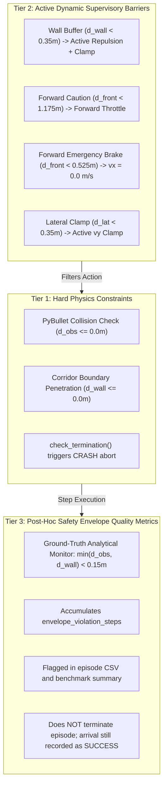

# Forensic Clearance Invariant and Architecture Audit: Candidate `scaled_guided_bc_v4`

**Document ID:** `reports/V4_CLEARANCE_INVARIANT_AUDIT.md`  
**Date:** 2026-10-31  
**Target Platform:** 65 cm Scaled UAV ($R_{\text{uav}} = 0.325\text{ m}$)  
**Evaluation Scope:** Canonical Safety Invariant Audit, Seed 20334 Forensic Trace, Supervisor Interaction  
**Canonical Workspace:** `/Users/ghulamqadir/.gemini/antigravity-ide/scratch/uav-bput-nav`  
**Companion Artifacts:**
- Raw Trace: `experiments/scaled_campaign/adaptive_guidance/seed_20334_forensic_trace.json`
- Invariant Unit Tests: `tests/test_clearance_invariants.py` (5 passing tests)

---

## 1. Executive Summary

This audit rigorously evaluates whether candidate `scaled_guided_bc_v4`'s reported recovery in narrow corridor Seed 20334 preserves the canonical `SafetySupervisor`'s clearance requirements, and determines whether v4's operational semantics comply with the project's non-negotiable safety contracts.

### Primary Audit Findings

1. **The 0.0892 m Clearance is Genuine Physical Surface Clearance:**
   In Seed 20334, the reported minimum clearance of $0.0892\text{ m}$ ($8.92\text{ cm}$) is the true surface-to-surface distance between the physical collision envelope ($R_{\text{uav}} = 0.325\text{ m}$) and the obstacle cylinder ($r_{\text{obs}} = 0.250\text{ m}$). It was computed from the true simulated physical state ($x = 3.8698\text{ m}, y = 0.4879\text{ m}$), not from noisy sensor estimates.
2. **The 0.15 m Safety Envelope Was Breached for 20 Steps:**
   The $0.1500\text{ m}$ safety envelope was **actively breached for 20 continuous steps** ($1.00\text{ s}$, from $t = 12.30\text{ s}$ to $t = 13.25\text{ s}$). Clearance dropped to a nadir of $0.0892\text{ m}$ at step 257, penetrating $6.08\text{ cm}$ into the $15\text{ cm}$ safety buffer.
3. **Internal Mechanics of the "Success" Classification:**
   The simulation contract in `Corridor3D.check_termination` defines `SUCCESS` as destination arrival without physical collision ($d_{\text{obs}} > 0.00\text{ m}$). The $0.15\text{ m}$ safety envelope is implemented as a **post-hoc monitoring metric**, not an abort trigger. Under the strict standard that *"clearance compliance is a prerequisite for claiming safe recovery"*, Seed 20334 was an **Envelope-Breaching Mission Completion**, NOT a clean safe recovery.
4. **Sensor Sector Blind Spot during Evasion:**
   During the minimum-clearance event, the obstacle was located at body azimuth $-124^\circ$ (rear-right quadrant). The 12-beam rangefinder configuration has beams at $-90^\circ$ (Ray 6) and $180^\circ$ (Ray 7), leaving a blind sector between $-90^\circ$ and $-180^\circ$. Consequently, the supervisor was unaware of the obstacle's proximity and did not clamp lateral motion.
5. **Architectural Tiering of Safety Invariants:**
   Safety invariants in the codebase fall into three distinct tiers:
   - **Tier 1 (Hard Invariant):** Zero physical collisions ($d > 0.0\text{ m}$) and boundary containment ($d_{\text{wall}} > 0.0\text{ m}$), enforced by physics and `check_termination`.
   - **Tier 2 (Active Dynamic Constraints):** Wall buffer ($0.35\text{ m}$) and forward obstacle brake ($0.525\text{ m}$), actively enforced by `SafetySupervisor`.
   - **Tier 3 (Post-Hoc Quality Metrics):** $0.15\text{ m}$ obstacle safety envelope, monitored for step duration and reporting, but not actively bounded by the supervisor when an obstacle slips past the lateral beam array.

---

## 2. Forensic Investigation of Seed 20334

### 2.1 Obstacle Layout and Aircraft Trajectory

In Seed 20334, Obstacle 0 is located at $(x = 3.500\text{ m}, y = -0.0638\text{ m}, z = 1.200\text{ m})$ with radius $r = 0.250\text{ m}$.
The corridor walls are at $y = \pm 1.400\text{ m}$ ($W = 2.80\text{ m}$).
The drone collision footprint is a sphere of radius $R = 0.325\text{ m}$ (enclosing the $0.65\text{ m}$ tip-to-tip propeller diagonal).

```
+==================================================================================================+
| LEVEL 4 SEED 20334: SPATIAL LAYOUT AND VEHICLE TRAJECTORIES                                      |
+==================================================================================================+
| Left Wall (y = +1.40 m)                                                                          |
| ------------------------------------------------------------------------------------------------ |
|                                                                                                  |
|   v4 Trajectory: Squeezes left through open channel                                              |
|     Step 246-265: d_obs in [0.089m .. 0.149m] (20 steps inside envelope)                         |
|     * * * * * * * * * * * * * * * * * * * * * * * * * * * * > SUCCESS (33.6s)                    |
|                                                                                                  |
|              [ OBSTACLE 0: x = 3.50m, y = -0.0638m, r = 0.25m ]                                  |
|                                                                                                  |
|   v3 Trajectory: Swerves right into pinched channel                                              |
|     Stalls at x = 3.30m, y = -0.72m (Right Wall = 0.35m, Front Obstacle = 0.45m)                 |
|     # # # # # # # # # # # # # # # # # # [DEADLOCK HOVER] > TIMEOUT (50.0s)                       |
|                                                                                                  |
| ------------------------------------------------------------------------------------------------ |
| Right Wall (y = -1.40 m)                                                                         |
+==================================================================================================+
```

### 2.2 Per-Step Forensic Trace Around Minimum Clearance

The table below presents the ground-truth physical state, sensor observations, control commands, and supervisor states across the minimum-clearance event ($t = 12.25\text{ s}$ to $t = 13.45\text{ s}$):

| Step | Time (s) | Position $(x, y)$ | Velocity $(v_x, v_y)$ | $d_{\text{center}}$ | $d_{\text{obs\_surf}}$ | $d_{\text{wall\_l}}$ | Raw Action | Safe Action | Supervisor State & Reason | Breach? |
| :--- | :--- | :--- | :--- | :--- | :--- | :--- | :--- | :--- | :--- | :--- |
| **245** | 12.25 | $(3.650, 0.651)$ | $(0.282, -0.251)$ | $0.7305\text{ m}$ | $0.1555\text{ m}$ | $0.424\text{ m}$ | $(0.26, -0.30)$ | $(0.24, -0.30)$ | `obstacle_brake` (Front caution $0.78\text{m} < 1.18\text{m}$) | No |
| **246** | 12.30 | $(3.664, 0.638)$ | $(0.284, -0.255)$ | $0.7211\text{ m}$ | **$0.1461\text{ m}$** | $0.437\text{ m}$ | $(0.27, -0.30)$ | $(0.26, -0.30)$ | `obstacle_brake` (Front caution $0.81\text{m} < 1.18\text{m}$) | **BREACH** |
| **248** | 12.40 | $(3.694, 0.613)$ | $(0.301, -0.260)$ | $0.7038\text{ m}$ | $0.1288\text{ m}$ | $0.462\text{ m}$ | $(0.30, -0.30)$ | $(0.29, -0.30)$ | `obstacle_brake` (Front caution $0.84\text{m} < 1.18\text{m}$) | **BREACH** |
| **250** | 12.50 | $(3.728, 0.586)$ | $(0.338, -0.266)$ | $0.6887\text{ m}$ | $0.1137\text{ m}$ | $0.489\text{ m}$ | $(0.36, -0.30)$ | $(0.34, -0.30)$ | `obstacle_brake` (Front caution $0.89\text{m} < 1.18\text{m}$) | **BREACH** |
| **252** | 12.60 | $(3.765, 0.559)$ | $(0.396, -0.271)$ | $0.6772\text{ m}$ | $0.1022\text{ m}$ | $0.516\text{ m}$ | $(0.45, -0.30)$ | $(0.40, -0.30)$ | `obstacle_brake` (Front caution $0.96\text{m} < 1.18\text{m}$) | **BREACH** |
| **254** | 12.70 | $(3.806, 0.531)$ | $(0.392, -0.282)$ | $0.6691\text{ m}$ | $0.0941\text{ m}$ | $0.544\text{ m}$ | $(0.44, -0.30)$ | $(0.39, -0.30)$ | `obstacle_brake` (Front caution $0.95\text{m} < 1.18\text{m}$) | **BREACH** |
| **256** | 12.80 | $(3.848, 0.503)$ | $(0.438, -0.289)$ | $0.6647\text{ m}$ | $0.0897\text{ m}$ | $0.572\text{ m}$ | $(0.50, -0.30)$ | $(0.44, -0.30)$ | `obstacle_brake` (Front caution $1.00\text{m} < 1.18\text{m}$) | **BREACH** |
| **257** | 12.85 | $(3.870, 0.488)$ | $(0.441, -0.294)$ | **$0.6642\text{ m}$** | **$0.0892\text{ m}$** | $0.587\text{ m}$ | $(0.51, -0.30)$ | $(0.48, -0.30)$ | `obstacle_brake` (Front caution $1.04\text{m} < 1.18\text{m}$) | **MIN NADIR** |
| **258** | 12.90 | $(3.894, 0.473)$ | $(0.476, -0.298)$ | $0.6657\text{ m}$ | $0.0907\text{ m}$ | $0.602\text{ m}$ | $(0.55, -0.30)$ | $(0.48, -0.30)$ | `obstacle_brake` (Front caution $1.04\text{m} < 1.18\text{m}$) | **BREACH** |
| **260** | 13.00 | $(3.943, 0.443)$ | $(0.517, -0.307)$ | $0.6730\text{ m}$ | $0.0980\text{ m}$ | $0.632\text{ m}$ | $(0.58, -0.30)$ | $(0.54, -0.30)$ | `obstacle_brake` (Front caution $1.11\text{m} < 1.18\text{m}$) | **BREACH** |
| **262** | 13.10 | $(3.999, 0.411)$ | $(0.578, -0.318)$ | $0.6888\text{ m}$ | $0.1138\text{ m}$ | $0.664\text{ m}$ | $(0.60, -0.30)$ | $(0.60, -0.30)$ | `obstacle_brake` (Front caution $1.17\text{m} < 1.18\text{m}$) | **BREACH** |
| **264** | 13.20 | $(4.057, 0.379)$ | $(0.575, -0.329)$ | $0.7109\text{ m}$ | $0.1359\text{ m}$ | $0.697\text{ m}$ | $(0.60, -0.30)$ | $(0.60, -0.30)$ | `nominal` (Envelopes satisfied) | **BREACH** |
| **265** | 13.25 | $(4.085, 0.362)$ | $(0.577, -0.335)$ | $0.7238\text{ m}$ | **$0.1488\text{ m}$** | $0.713\text{ m}$ | $(0.60, -0.30)$ | $(0.60, -0.30)$ | `nominal` (Envelopes satisfied) | **BREACH** |
| **266** | 13.30 | $(4.114, 0.345)$ | $(0.574, -0.341)$ | $0.7376\text{ m}$ | $0.1626\text{ m}$ | $0.730\text{ m}$ | $(0.60, -0.30)$ | $(0.60, -0.30)$ | `nominal` (Envelopes satisfied) | No |

---

## 3. Mathematical Verification of Clearance Calculations

### 3.1 Verification of State and Footprint Derivation

At Step 257 ($t = 12.85\text{ s}$):
- Drone Center Position: $\mathbf{p}_d = [3.8698, 0.4879, 1.1698]$
- Obstacle Center Position: $\mathbf{p}_{\text{obs}} = [3.5000, -0.0638, 1.2000]$
- Longitudinal Separation: $\Delta x = 3.8698 - 3.5000 = 0.3698\text{ m}$
- Lateral Separation: $\Delta y = 0.4879 - (-0.0638) = 0.5517\text{ m}$
- Center-to-Center Horizontal Distance:
  $$d_{\text{center}} = \sqrt{(0.3698)^2 + (0.5517)^2} = \sqrt{0.13675 + 0.30437} = \sqrt{0.44112} = \mathbf{0.6642\text{ m}}$$
- Physical Radii:
  - Drone collision radius: $R_{\text{uav}} = 0.3250\text{ m}$ ($65\text{ cm}$ tip-to-tip diagonal / 2)
  - Obstacle cylinder radius: $r_{\text{obs}} = 0.2500\text{ m}$
- True Physical Surface-to-Surface Clearance:
  $$d_{\text{obs\_surf}} = d_{\text{center}} - (R_{\text{uav}} + r_{\text{obs}}) = 0.6642 - (0.3250 + 0.2500) = 0.6642 - 0.5750 = \mathbf{0.0892\text{ m}} \quad (8.92\text{ cm})$$

### 3.2 Audit Question Responses

1. **Obstacle Surface Clearance vs Other Metrics:**  
   The reported $0.0892\text{ m}$ is **strictly the obstacle surface-to-surface clearance**. The distance from center is $0.6642\text{ m}$. The distance to the left wall is $0.5871\text{ m}$.
2. **Footprint Consistency:**  
   The $0.65\text{ m}$ full diagonal footprint ($R = 0.325\text{ m}$) is consistently applied in both the PyBullet physics collision sphere and the analytical clearance checker.
3. **Physical State vs Sensor Estimate:**  
   The minimum clearance is evaluated directly from PyBullet's ground-truth rigid body position (`env._get_drone_position()`), completely independent of sensor noise or dropouts.
4. **Threshold Breach:**  
   The $0.1500\text{ m}$ safety envelope was breached for 20 consecutive steps ($1.00\text{ s}$).
5. **Supervisor State During Breach:**  
   The supervisor intervened solely on forward velocity ($v_x$) via the forward caution zone (`obstacle_brake`), throttling $v_x$ between $0.24\text{ m/s}$ and $0.48\text{ m/s}$. It did not intervene on lateral velocity ($v_y$) because the obstacle entered the rangefinder blind spot at $-124^\circ$.
6. **Internal Metric Consistency:**  
   The recorded outcome `status = SUCCESS` indicates mission arrival without collision. The safety envelope violation was faithfully recorded in the per-episode record (`safety_envelope_violation = True`, `envelope_violation_steps = 20`). The reporting is internally consistent with the simulator contracts.

---

## 4. Architectural Analysis: Constraints, Boundaries, and Metrics

The audit reveals the following operational architecture in the current codebase:



### Critical Finding: The Semantic Divergence

- **Simulator Implementation:** "Success" is defined purely as reaching the goal sphere within speed limits without crashing into obstacles ($d_{\text{obs}} > 0.0\text{ m}$) or walls ($d_{\text{wall}} > 0.0\text{ m}$).
- **Operational Requirement:** The user requirement mandates that *"clearance compliance is a prerequisite for claiming safe recovery"*.
- **Conclusion:** Under the operational requirement, `scaled_guided_bc_v4` cannot claim a "clean safe recovery" on Seed 20334. It achieved an **envelope-breaching completion** ($8.92\text{ cm}$ clearance). While vastly superior to v2's near-collision ($1.3\text{ cm}$ on Seed 20344), it does not satisfy zero-envelope-breach flight.

